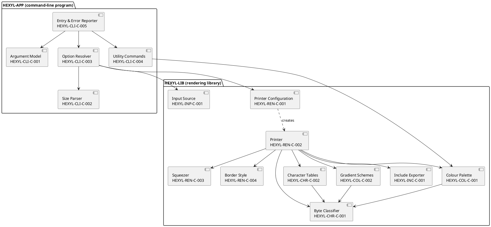
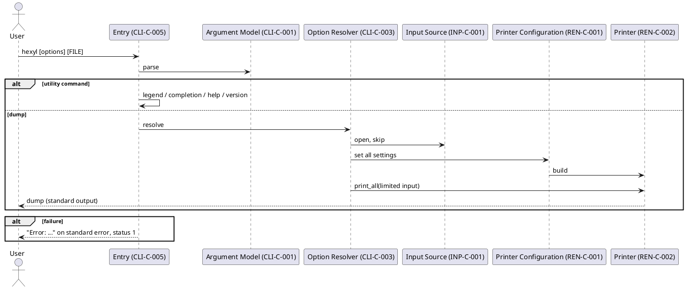
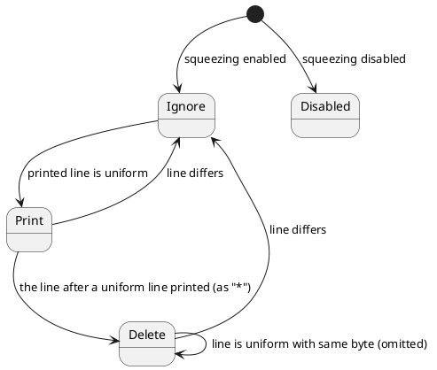
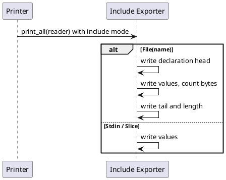

# HEXYL-ARCH-001 — hexyl architecture description

## Purpose

Describe the decomposition of hexyl into two deliverable parts and into the logical components of each area.

## Description

### Stakeholders and concerns

| Stakeholder | Concerns |
| --- | --- |
| Terminal user | correct and readable output, option behaviour |
| Script author | stable output, exit status, streaming |
| Library user | a rendering engine independent of the CLI |
| Maintainer | separation of concerns, testability of rendering without a terminal |

### Decomposition (two parts)

- **Rendering library** (`HEXYL-LIB`): areas rendering, character, colour, include-export, and the input-source abstraction. It writes to any output sink and reads from any byte source.
- **Command-line program** (`HEXYL-APP`): area cli, which depends on the library. It owns argument parsing, size parsing, option resolution, standard stream wiring, error reporting, and the colour legend.

Rule (observed): the library never reads the command line, the terminal width or `NO_COLOR`. The program resolves those and gives the library plain settings. Exception (observed): the colour configuration reads the `HEXYL_COLOR_*` variables inside the library (`HEXYL-COL-C-001`).

### Component view



### Main flow



### Design decisions (observed)

| ID | Decision |
| --- | --- |
| ARCH-D-1 | The dump is produced in a single pass over a bounded buffer of one line (8 × P bytes). |
| ARCH-D-2 | The per-byte hex strings, char strings and colour codes are precomputed per printer (a 256-entry table each), not per use. |
| ARCH-D-3 | The squeezing logic is a state machine inside the printer. |
| ARCH-D-4 | The library is extensible by new tables and schemes; the tables and schemes are closed sets (not user-extensible at run-time). |

## Constraints

- The library shall be usable without the CLI.
- The program shall not render the dump itself.

## References

- Refines: `HEXYL-SYS-001`, all L2 areas
- Detailed by: L4 documents of each area

## Components — Command-line interface

| ID | Component | Responsibility | Realises |
| --- | --- | --- | --- |
| HEXYL-CLI-C-001 | Argument Model | Declares options, aliases, defaults, value sets, conflicts and help texts; parses the command line into a typed option set. | CLI-F-001, 003, 005–016 |
| HEXYL-CLI-C-002 | Size Parser | Parses signed/unsigned byte counts with sign, unit, hex notation, block size; reports typed parse errors. | CLI-F-003, 004, 005, 006, 007 |
| HEXYL-CLI-C-003 | Option Resolver | Combines the option set with environment (NO_COLOR, terminal width, standard streams) into printer settings and an input reader (skip, limit); computes panel count; runs the dump. | CLI-F-002, 003, 005, 007, 009–014, 016, INP-F-004, 005 |
| HEXYL-CLI-C-004 | Utility Commands | Colour legend and completion generation. | CLI-F-017 |
| HEXYL-CLI-C-005 | Entry & Error Reporter | Calls the others, converts failures into `Error: ...` and exit status, maps a closed pipe to quiet success. | CLI-F-018 |

### Interfaces

| Interface | Provider | Consumer | Content |
| --- | --- | --- | --- |
| IF-CLI-1 | Argument Model | Option Resolver | typed option set |
| IF-CLI-2 | Size Parser | Option Resolver | `parse_byte_offset(text, block_size) → ByteOffset`; `ByteOffset` has a non-negative value and a kind |
| IF-CLI-3 | Option Resolver | Printer Configuration (REN-C-001) | settings |
| IF-CLI-4 | Option Resolver | Input Source (INP-C-001) | open, skip, limit |

```plantuml
@startuml
class OptionSet
class ByteOffset { value : NonNegativeInteger }
enum ByteOffsetKind { ForwardFromBeginning ForwardFromLastOffset BackwardFromEnd }
enum Unit { Byte Kilobyte Megabyte Gigabyte Terabyte Kibibyte Mebibyte Gibibyte Tebibyte Block }
ByteOffset --> ByteOffsetKind
SizeParser ..> ByteOffset
SizeParser ..> Unit
OptionResolver ..> OptionSet
OptionResolver ..> SizeParser
@enduml
```

### Constraints

- Argument Model and Size Parser shall not perform input/output.

## Components — Input

| ID | Component | Responsibility |
| --- | --- | --- |
| HEXYL-INP-C-001 | Input Source | A sum of two variants (file, standard input) offering *read* and *seek*. Seek on a variant that cannot seek falls back to discarding bytes for forward relative skips, and fails otherwise. It can be converted into a plain byte reader once positioned. |

```plantuml
@startuml
interface Reader { read(buffer) : count }
interface Seeker { seek(position) : absolutePosition }
class InputSource
InputSource ..|> Reader
InputSource ..|> Seeker
InputSource o-- "0..1" FileHandle
InputSource o-- "0..1" StandardInput
@enduml
```

### Constraints

- The input source is owned by the Option Resolver until it is converted into a reader (`HEXYL-CLI-C-003`).

## Components — Rendering

| ID | Component | Responsibility | Realises |
| --- | --- | --- | --- |
| HEXYL-REN-C-001 | Printer Configuration | Collects display settings with defaults (colour on, char panel on, position panel on, unicode border, squeezing on, 2 panels, group 1, hexadecimal, big endian, default table, include off, default scheme) and builds a Printer; precomputes the per-byte text tables. | REN-F-001–007 |
| HEXYL-REN-C-002 | Printer | Reads input line by line, writes borders, position panel, numeric panels, character panel, and ending lines; owns the display offset and current colour. | REN-F-001–010, 012 |
| HEXYL-REN-C-003 | Squeezer | State machine that decides, per line, whether it is printed, shown as `*`, or omitted. | REN-F-008 |
| HEXYL-REN-C-004 | Border Style | Provides for each style the header/footer elements and the inner/outer separators. | REN-F-005 |

### Interfaces

| Interface | Content |
| --- | --- |
| IF-REN-1 | Configuration setters, then `build() → Printer` |
| IF-REN-2 | `Printer.display_offset(n)`; `Printer.print_all(reader)`; also `print_header`, `print_footer`, `print_bytes`, `print_char_panel` |
| IF-REN-3 | Printer → output sink: write bytes, flush |

### Class model

```plantuml
@startuml
class PrinterConfiguration {
  showColor : Boolean
  showCharPanel : Boolean
  showPositionPanel : Boolean
  borderStyle : BorderStyle
  squeezing : Boolean
  panels : PositiveInteger
  groupSize : Integer
  base : Base
  endianness : Endianness
  characterTable : CharacterTable
  includeMode : IncludeMode
  colorScheme : ColorScheme
}
class Printer {
  lineBuffer
  displayOffset
  index
  squeezer
}
enum BorderStyle { Unicode Ascii None }
enum Base { Binary Octal Decimal Hexadecimal }
enum Endianness { Little Big }
enum IncludeMode { File Stdin Slice Off }
PrinterConfiguration ..> Printer : build
Printer --> BorderStyle
Printer --> Base
Printer --> Endianness
Printer --> IncludeMode
@enduml
```

### Squeezer state model



Remarks: the `Print`/`Delete`/`Ignore` names are an implementation view; the state names are logical here. A transient use of `Print` also serves to pad the incomplete last line (L4).

### Constraints

- Printer shall not hold more than one line of data (ARCH-D-1).

## Components — Characters

| ID | Component | Responsibility |
| --- | --- | --- |
| HEXYL-CHR-C-001 | Byte Classifier | Pure function `byte → category`. |
| HEXYL-CHR-C-002 | Character Tables | Pure function `(table, byte) → character`; contains the constant 256-entry tables of CP437 and CP1047 and the rules of the default, ascii and braille tables. |

```plantuml
@startuml
enum ByteCategory { Null AsciiPrintable AsciiWhitespace AsciiOther NonAscii }
enum CharacterTable { Default Ascii CP437 CP1047 Braille }
class ByteClassifier { category(byte) : ByteCategory }
class CharacterTables { glyph(table, byte) : Character }
CharacterTables ..> ByteClassifier
CharacterTables ..> CharacterTable
ByteClassifier ..> ByteCategory
@enduml
```

### Constraints

- Both components are stateless.

## Components — Colour

| ID | Component | Responsibility |
| --- | --- | --- |
| HEXYL-COL-C-001 | Colour Palette | Holds the terminal sequences of the default scheme and of the offset and the reset sequence. Each is computed on first use from the default colour and the matching `HEXYL_COLOR_*` variable. Provides `colour(scheme, byte)` for the default scheme. |
| HEXYL-COL-C-002 | Gradient Schemes | Constant tables of 24-bit colour sequences for the gradient scheme (NULL, DEL, printable, non-printable, non-ASCII), built from colour stops by linear interpolation. Provides `colour(scheme, byte)` for the gradient scheme. |

```plantuml
@startuml
enum ColorScheme { Default Gradient }
class ColourPalette {
  null, offset, printable, whitespace, other, nonAscii : EscapeSequence
  reset : EscapeSequence
}
class GradientSchemes {
  nonAscii[128], nonPrintable[31], printable[95]
  nullColour, delColour
}
ColourPalette ..> ColorScheme
GradientSchemes ..> ColorScheme
@enduml
```

### Constraints

- Reading of the environment is lazy and happens once per process, per variable.

## Components — C include export

| ID | Component | Responsibility |
| --- | --- | --- |
| HEXYL-INC-C-001 | Include Exporter | When the Printer's include mode is not `Off`, reads the whole remaining input in blocks, writes the formatted values, counts the bytes, and (for the `File` mode) writes the declaration and length lines. It bypasses the dump layout components. |

The mode `Slice` is accepted by the Printer and behaves like `Stdin`; no program path selects it (OBSERVED; intended for library users).



